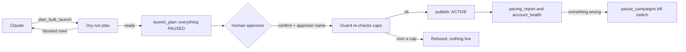

# Meta Ads Launch Guard

Launch Meta ads across 30 accounts from one Claude chat, with spend caps, paused-first launches and a human approval before anything goes live.

[](https://github.com/dwadlane/meta-ads-launch-guard/actions/workflows/ci.yml)

Current as of Marketing API v27.0. Built on the MCP TypeScript SDK 1.x, protocol 2025-11-25.



## Quick Start

```bash
git clone https://github.com/dwadlane/meta-ads-launch-guard
cd meta-ads-launch-guard
npm install && npm run build
npm run demo      # scripted Claude flow on the local mock
npm test          # 43 tests
npm run smoke     # stdio smoke test
```

Add it to Claude Desktop or Claude Code:

```json
{ "mcpServers": { "meta-ads-launch-guard": { "command": "node", "args": ["/path/to/meta-ads-launch-guard/dist/index.js"] } } }
```

It runs on a local mock with 30 fictional ad accounts across 3 businesses (Northside Dental, Coastal Moving Co, Peak Fitness Studios). Nothing touches Meta.

## Tools

| Tool | What it does |
|---|---|
| `list_ad_accounts` | Every ad account, its business, currency and daily cap. |
| `account_health` | Spend today against the cap, disapproved ads, pacing, and what needs a look. |
| `plan_bulk_launch` | Takes a launch spec (accounts, template, budgets, creatives, audiences). Returns a dry-run plan with a total daily spend and one row per account. Creates nothing. |
| `launch_plan` | Creates the campaigns, ad sets, creatives and ads, all PAUSED, and returns ids. A retry never double-creates. |
| `publish` | Flips a launched plan to ACTIVE. Needs `confirm=true` and an approver name. Refuses if any account or the global total would exceed its cap. |
| `pause_campaigns` | Kill switch for one account or all. |
| `pacing_report` | Spend against budget from insights, flagging over and under pacing. |
| `adjust_budget` | Changes a budget, refusing any move over the per-edit limit (30%) or any raise that breaks a cap. |

## Guardrails

All in `guard.json`:

- Per-account daily spend caps, plus a global cap.
- Max budget change per edit (30%).
- Naming convention enforced by regex.
- Creative check: headline length, body length, missing or non-https URL.
- Idempotent launch keys, so a retry never double-creates.
- v27 guards: explicit `targeting_automation.individual_setting.device`, Product showcase set to OPT_OUT, and a check for the fields v27 rejects (`lookalike_spec.country`, `location_spec`).

## Demo Excerpt

From [`examples/demo-output.md`](examples/demo-output.md), a real run of `npm run demo`:

> Plan `plan_16aa9113bd`: 12 accounts, total A$960.00 a day, **1 blocked**.
>
> **Claude:** One account is blocked. Northside Dental Parramatta: A$50.00 already live plus A$80.00 new is A$130.00, over the A$120.00 daily cap by A$10.00. The most this account can take is A$70.00.
>
> Result: 0 created, 12 replayed. A retry creates nothing twice.
>
> Result (refused): "Claude" is not a person. publish needs the name of the human who approved this launch.
>
> Result: published. Approved by Sam Rivera, 12 campaigns active, A$940.00 a day.
>
> Six hours later: 30 accounts checked, **2 flagged** (Northside Dental Chatswood over at 1.7x, Coastal Moving Co Gold Coast under at 0.3x).

## Risk Matrix

What could go wrong, and the guard that stops it: [docs/risk-matrix.md](docs/risk-matrix.md).

## Going Live

The HTTP client is already in the box. Set these and the same tools run against the real Graph API:

| Variable | Meaning |
|---|---|
| `META_ACCESS_TOKEN` | A token with `ads_management` (and `ads_read` for insights). |
| `META_ALLOW_LIVE` | Must be `1`. A token alone is not enough. |
| `META_API_VERSION` | Defaults to `v27.0`. |
| `META_GRAPH_BASE_URL` | Defaults to `https://graph.facebook.com`. |
| `META_PAGE_ID` | Facebook Page used by ad creatives. |
| `GUARD_FILE` | Path to your own `guard.json`. |

Graph endpoints modelled by the mock and the client: `GET /me/adaccounts`, `GET /act_<id>/campaigns`, `adsets`, `ads`, `POST /act_<id>/campaigns`, `adsets`, `adcreatives`, `ads`, `POST /<id>` (status and daily budget) and `GET /act_<id>/insights?date_preset=today`.

Live use needs a Meta app that has passed app review with the `ads_management` permission. The live client has not been run against Meta in tests or the demo, so treat the first live run as a supervised one with low caps. Pacing uses UTC days and an even-spread estimate, and it is a flag for a person to look at.

## When It Stops

It stops, and says why in plain words, when:

- a row would put an account over its daily cap, or the plan would put all accounts over the global cap;
- a name breaks the naming convention, or a creative is missing a link or has a headline that is too long;
- `publish` is called without `confirm=true`, or without the name of a human approver;
- another launch has used up the headroom since the plan was made;
- a budget edit is bigger than 30%.

Nothing goes live on a refusal. The kill switch needs no confirmation.

## License

MIT. See [LICENSE](LICENSE). Report security issues as described in [SECURITY.md](SECURITY.md).

Built by Gaps2Gains. [Book a Free Discovery Call](https://gaps2gains.com/diagnosis)
